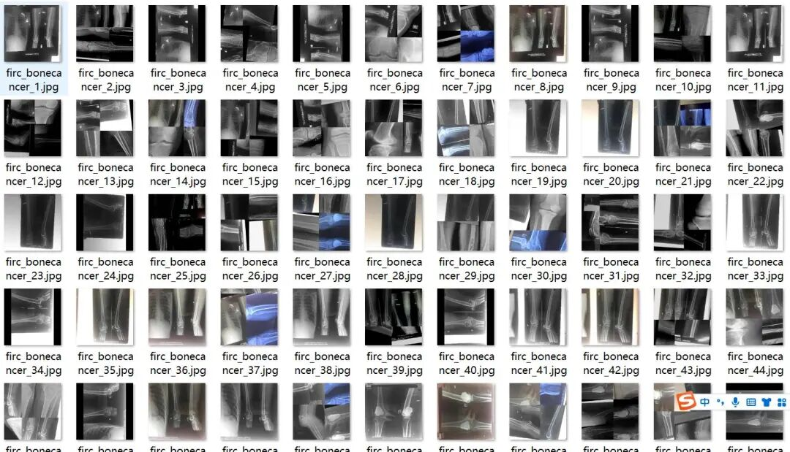
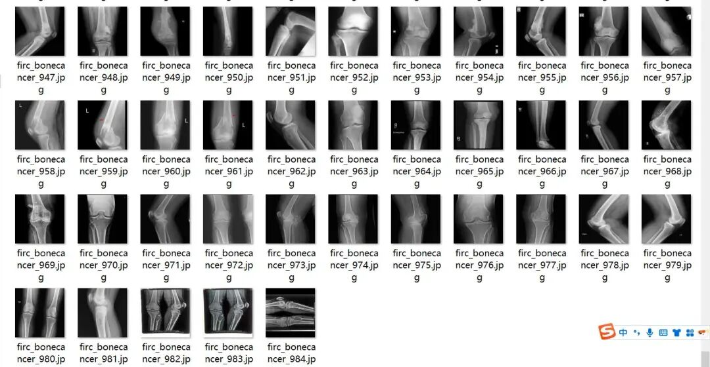
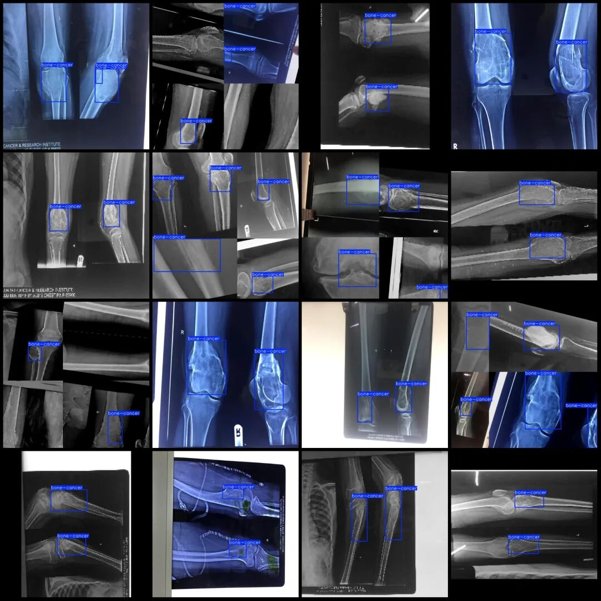

# VOC+YOLO format: 984 images in one category for bone cancer detection dataset

Dataset format: Pascal VOC format + YOLO format (txt file without split path, only containing jpg images and corresponding VOC format xml files and yolo format txt files)

Number of images (number of jpg files): 984

Number of annotations (number of xml files): 984

Number of annotations (number of txt files): 984

Label category count: 1

Label category names (Note that the order of categories in the YOLO format does not correspond to this, but is based on the labels folder's classes.txt): ["bone-cancer"]

Number of boxes labeled in each category:

Bone-cancer frame count = 2484

Total frame count: 2484

Using labelImg:

Annotation rules: Draw a rectangle around the category.

Important Notice: No

Image resolution: 640x640

Is the dataset enhanced: Yes, mainly 4 images stitched together for enhancement.

Special : This dataset does not guarantee the accuracy of the trained models or weight files.

Image Preview:

Annotation example:

## Payment

Here is a pay link on Stripe ( https://buy.stripe.com/3cs8yP7sY87d0vu9AB ). Please contact me lonlonago@foxmail.com after funding $89, and I will send you a complete data files , thank you!

